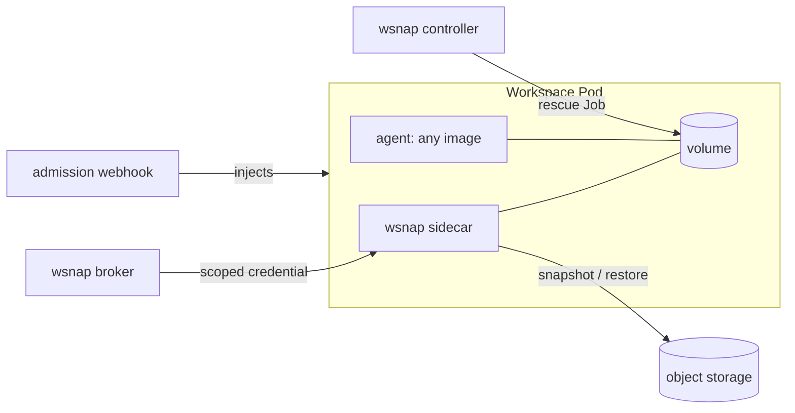

# wsnap

wsnap keeps an agent's workspace alive across Pods on Kubernetes.

An AI agent works in a directory on a volume. wsnap copies that directory
to a snapshot repository while the Pod runs, takes a final snapshot during
a normal shutdown, and restores the last recorded snapshot before the next
agent starts. If a Pod dies, wsnap can save newer data from its released
PV when that PV is still accessible.

It works with any agent image and any workload that creates Pods: plain
Pods, Deployments, StatefulSets, and [agent-sandbox](https://github.com/kubernetes-sigs/agent-sandbox)
`Sandbox` objects.

> **Status:** prototype (`wsnap.dev/v1alpha1`). The API can change. No
> release has been published yet; install from source.

## Recovery depends on the volume

| Workspace volume | Normal shutdown | Pod crash or deletion without a final snapshot | Lost volume or node |
|---|---|---|---|
| Standalone PVC | Final snapshot; the next Pod can reuse the PVC. | The next Pod can reuse the PVC if it remains accessible. If the PVC is deleted and its PV is released, a mover can save it first. | Restore the last completed snapshot on a new volume; later writes may be lost. |
| Generic ephemeral PVC | Final snapshot, then restore into the next Pod's new PVC. | A mover Job saves the released PV if it is accessible, then the next Pod restores it. | Restore the last completed snapshot; later writes may be lost. |
| `emptyDir` | Final snapshot, then restore into the next Pod. | The volume disappears with the Pod; restore the last completed snapshot. | Restore the last completed snapshot; later writes may be lost. |

For a node-local PV, a permanent node loss can also make the PV
inaccessible. Choose the snapshot interval for the amount of recent work
you can afford to lose. See [architecture.md](docs/architecture.md) for
the recovery flow.

## What it supports

| Area | Choices |
|---|---|
| Snapshot technology | Kopia, restic, or any tool behind a small `exec` contract |
| Storage | S3-compatible (AWS S3, MinIO, Ceph RGW, R2, SeaweedFS, ...), Google Cloud Storage, Azure Blob, shared filesystem |
| Credentials | One credential per workspace and per role: `s3-sts`, `gcs-downscoped`, `azure-sas`, or `static` |
| Workspace volume | PVC, generic ephemeral volume, `emptyDir` |
| Who does the work | An in-Pod sidecar, or a worker Pod beside the workload (same node and PVC), while the Pod runs; a Job when no Pod runs |
| Triggers | Schedule, Pod shutdown, `WorkspaceSnapshot`/`WorkspaceRestore` objects, an HTTP gateway API, a file the agent writes |
| Restore | Newest snapshot, a pinned snapshot (rollback), or another workspace's snapshot (fork); at start or in a running Pod |

wsnap needs no cloud-specific API. It needs Kubernetes 1.30 or later.

Read the [documentation site](https://chrisyifanjin.github.io/wsnap/) for
setup, recovery behavior, security, and the API.

## How it works



1. You label a Pod with `wsnap.dev/workspace` and `wsnap.dev/repository`.
   The admission webhook adds the sidecar.
2. The sidecar asks the broker for a credential. The broker checks the Pod
   and gives a credential that opens this workspace only, for one role.
3. Before the agent starts, the sidecar restores the newest snapshot.
4. While the agent runs, the sidecar takes snapshots, but only when files
   changed.
5. When the Pod stops, the sidecar takes the final snapshot.
6. If a PVC is deleted without a final snapshot and its PV is still
   accessible, the controller can save the released PV with a Job.

Read [docs/architecture.md](docs/architecture.md) for the full design.

## Quick start from source

You need a Kubernetes 1.30+ cluster, Docker, Go, `kubectl`, and an S3
bucket with credentials that can assume a workspace role. The example
below uses kind; see [operations.md](docs/operations.md) for other
clusters and storage backends.

```sh
kind create cluster --name wsnap
make images
kind load docker-image wsnap-controller:dev wsnap-agent:dev --name wsnap
kubectl apply -k config/default
kubectl -n wsnap-system rollout status deployment/wsnap-controller

kubectl create namespace agents
kubectl -n agents create secret generic wsnap-creds \
  --from-literal=WSNAP_MASTER_KEY="$(openssl rand -hex 32)" \
  --from-literal=AWS_ACCESS_KEY_ID=... --from-literal=AWS_SECRET_ACCESS_KEY=...
# First edit the sample's bucket, region and role ARN for your S3 account.
kubectl -n agents apply -f config/samples/repository-s3-sts.yaml
kubectl -n agents get snaprepo default
kubectl -n agents apply -f config/samples/pod.yaml
kubectl -n agents wait --for=condition=Ready pod/my-agent --timeout=5m
```

The repository, its Secret and the workload must be in the **same
namespace**. `Ready=True` on the repository means that its configuration
and Secret are valid; the first snapshot also checks access to storage.
The sample Pod uses a generic ephemeral volume and gets its sidecar from
the webhook. Write a file, delete the Pod, then re-create it to see a
restore:

```sh
kubectl -n agents exec my-agent -c agent -- sh -c 'echo hello > /workspace/hello.txt'
kubectl -n agents delete pod my-agent
kubectl -n agents apply -f config/samples/pod.yaml
kubectl -n agents wait --for=condition=Ready pod/my-agent --timeout=5m
kubectl -n agents exec my-agent -c agent -- cat /workspace/hello.txt
```

Keep `WSNAP_MASTER_KEY` safe: losing it makes existing snapshots
unreadable. For agent-sandbox, see [sandbox.yaml](config/samples/sandbox.yaml).
For other backends, TLS, monitoring and uninstall, see
[operations.md](docs/operations.md).

## Tested

| | filesystem | S3: MinIO | S3: SeaweedFS | GCS (emulator) | Azure (Azurite, TLS) |
|---|---|---|---|---|---|
| Kopia | ✅ | ✅ STS + e2e | ✅ | ✅ | ✅ key and SAS |
| restic | ✅ | ✅ STS + e2e | ✅ | ✅ token | ✅ key¹ |
| exec | ✅ + e2e | | | | |

¹ restic cannot create a repository with a container SAS; the validator
refuses that combination.

Container runtimes: runc (containerd) and gVisor (runsc), in both sidecar
and worker mode. Kata Containers is not tested yet.

Kubernetes versions: every scenario runs on 1.37; the volume and worker
scenarios also run on 1.30, the oldest supported version.

The end-to-end suite runs on a three-node kind cluster with agent-sandbox.
It injects failures: the controller stopped, the leader killed during a
rescue, storage stopped, the sidecar killed, a crash with an immediate
replacement. See [docs/verification.md](docs/verification.md).

## Documentation

| Document | Contents |
|---|---|
| [architecture.md](docs/architecture.md) | Parts, objects, flows, state machines, consistency rules |
| [security.md](docs/security.md) | Threat model, authentication, roles, providers, fail-closed behavior, limits |
| [operations.md](docs/operations.md) | Install, repositories per backend, workloads, requests, metrics, troubleshooting, uninstall |
| [api.md](docs/api.md) | Custom resources, labels, broker HTTP API, exec engine contract |
| [verification.md](docs/verification.md) | Test layers, how to run them, bugs they found |
| [engineering.md](docs/engineering.md) | How the code is organized and changed: package boundaries, one owner per safety rule, contracts, PR evidence |

## Development

```sh
make build vet test      # unit tests
make generate            # CRDs and deepcopy (controller-gen)
make images              # controller and agent images
make e2e                 # on a kind cluster named wsnap
```

## License

Apache License 2.0. See [LICENSE](LICENSE).
