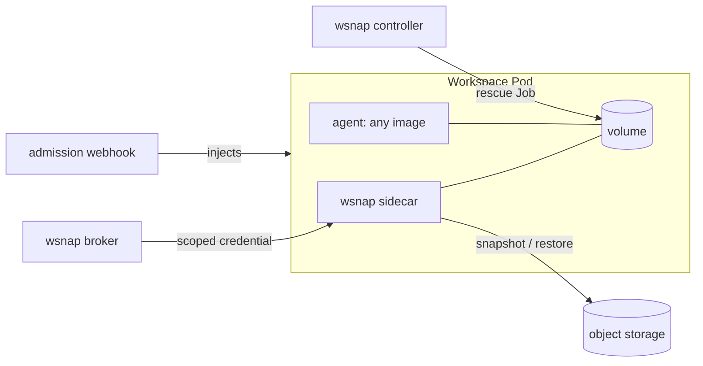

# wsnap

wsnap keeps an agent's workspace alive across Pods on Kubernetes.

An AI agent works in a directory on a volume. When its Pod stops (an idle
sandbox is suspended, a node fails, a user deletes the sandbox), the work
must not be lost. wsnap takes snapshots of the workspace volume to object
storage while the Pod runs, takes a final snapshot when the Pod stops, and
restores the newest snapshot into the next Pod before the agent starts.

It works with any agent image and any workload that creates Pods: plain
Pods, Deployments, StatefulSets, and [agent-sandbox](https://github.com/kubernetes-sigs/agent-sandbox)
`Sandbox` objects.

> **Status:** prototype (`wsnap.dev/v1alpha1`). The API can change.

## What it supports

| Area | Choices |
|---|---|
| Snapshot technology | Kopia, restic, or any tool behind a small `exec` contract |
| Storage | S3-compatible (AWS S3, MinIO, Ceph RGW, R2, SeaweedFS, ...), Google Cloud Storage, Azure Blob, shared filesystem |
| Credentials | One credential per workspace and per role: `s3-sts`, `gcs-downscoped`, `azure-sas`, or `static` |
| Workspace volume | PVC, generic ephemeral volume, `emptyDir` |
| Who does the work | An in-Pod sidecar while the Pod runs; a Job when no Pod runs |
| Triggers | Schedule, Pod shutdown, `WorkspaceSnapshot`/`WorkspaceRestore` objects, an HTTP gateway API, a file the agent writes |
| Restore | Newest snapshot, a pinned snapshot (rollback), or another workspace's snapshot (fork); at start or in a running Pod |

wsnap needs no cloud-specific API. It needs Kubernetes 1.29 or later.

## How it works



1. You label a Pod with `wsnap.dev/workspace` and `wsnap.dev/repository`.
   The admission webhook adds the sidecar.
2. The sidecar asks the broker for a credential. The broker checks the Pod
   and gives a credential that opens this workspace only, for one role.
3. Before the agent starts, the sidecar restores the newest snapshot.
4. While the agent runs, the sidecar takes snapshots, but only when files
   changed.
5. When the Pod stops, the sidecar takes the final snapshot.
6. If a Pod dies without a final snapshot, the controller rescues its volume
   with a Job.

Read [docs/architecture.md](docs/architecture.md) for the full design.

## Quick start

```sh
make images
# Make both images available to cluster nodes (for kind, use kind load docker-image).
kubectl apply -k config/default
kubectl create secret generic wsnap-creds \
  --from-literal=WSNAP_MASTER_KEY="$(openssl rand -hex 32)" \
  --from-literal=AWS_ACCESS_KEY_ID=... --from-literal=AWS_SECRET_ACCESS_KEY=...
# Set the bucket, endpoint, region and STS role in the sample for your store.
kubectl apply -f config/samples/repository-s3-sts.yaml
```

Then add two labels and a volume named `workspace` to your workload:

```yaml
metadata:
  labels:
    wsnap.dev/workspace: user-42-project-x
    wsnap.dev/repository: default
```

See [docs/operations.md](docs/operations.md) for each backend, TLS,
monitoring and uninstall.

## Tested

| | filesystem | S3: MinIO | S3: SeaweedFS | GCS (emulator) | Azure (Azurite, TLS) |
|---|---|---|---|---|---|
| Kopia | ✅ | ✅ STS + e2e | ✅ | ✅ | ✅ key and SAS |
| restic | ✅ | ✅ STS + e2e | ✅ | ✅ token | ✅ key¹ |
| exec | ✅ + e2e | | | | |

¹ restic cannot create a repository with a container SAS; the validator
refuses that combination.

The end-to-end suite runs on a three-node kind cluster with agent-sandbox.
It injects failures: the controller stopped, the leader killed during a
rescue, storage stopped, the sidecar killed, a crash with an immediate
replacement. See [docs/verification.md](docs/verification.md).

## Documentation

| Document | Contents |
|---|---|
| [architecture.md](docs/architecture.md) | Parts, objects, flows, state machines, consistency rules |
| [security.md](docs/security.md) | Threat model, authentication, roles, providers, fail-closed behavior, limits |
| [operations.md](docs/operations.md) | Install, repositories per backend, workloads, requests, metrics, troubleshooting, uninstall |
| [api.md](docs/api.md) | Custom resources, labels, broker HTTP API, exec engine contract |
| [verification.md](docs/verification.md) | Test layers, how to run them, bugs they found |

## Development

```sh
make build vet test      # unit tests
make generate            # CRDs and deepcopy (controller-gen)
make images              # controller and agent images
make e2e                 # on a kind cluster named wsnap
```

## License

Apache License 2.0. See [LICENSE](LICENSE).
