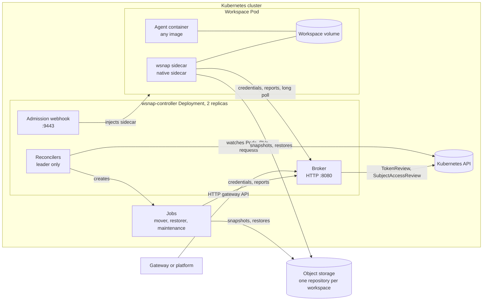
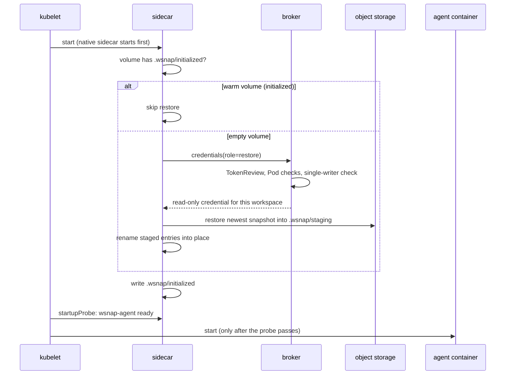
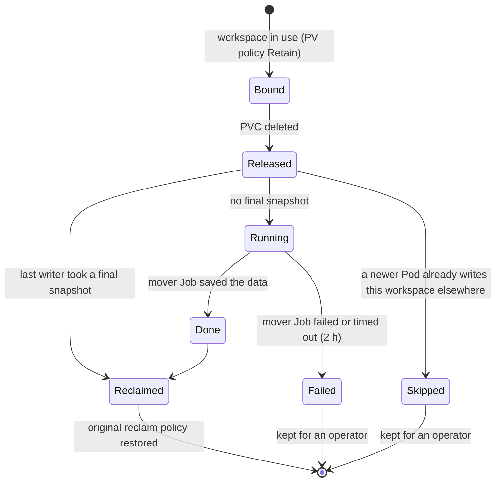
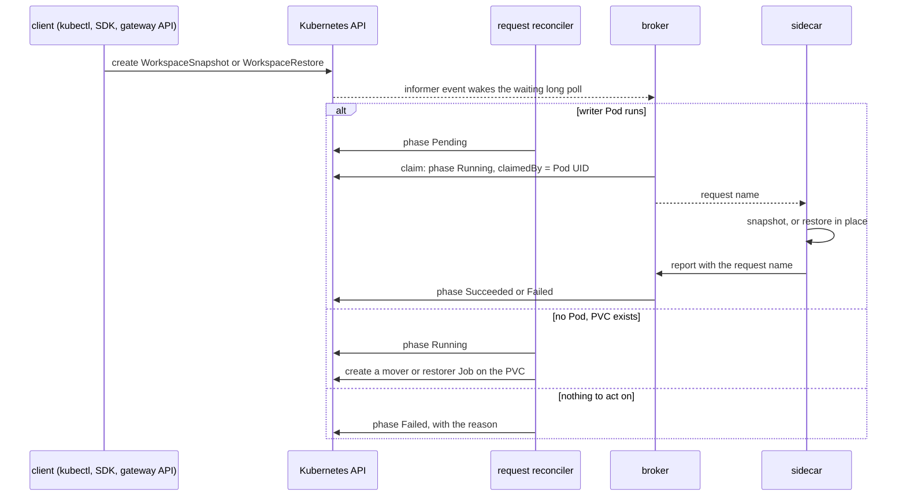

# Architecture

This document explains how wsnap works. It names each part, shows how the
parts talk to each other, and describes each flow step by step.

## The problem

An agent works in a directory: the workspace. The workspace lives on a
volume in a Pod. Pods are temporary. A Pod stops when its node fails, when
the platform suspends an idle agent, or when a user deletes a sandbox. When
the Pod stops, the workspace must not be lost, and the next Pod must start
with it.

wsnap keeps a workspace alive across Pods. It stores snapshots of the
workspace volume in object storage. It restores the newest snapshot into
the next Pod before the agent starts.

## Parts



| Part | Where it runs | What it does |
|---|---|---|
| Broker | controller, every replica | Gives each agent a credential for one workspace and one role. Records snapshot and restore results. Serves the long poll and the gateway API. |
| Admission webhook | controller, every replica | Adds the sidecar to Pods with the `wsnap.dev/workspace` label. Refuses Pods that it cannot protect. |
| Pod reconciler | controller, leader | Creates the Workspace object. Switches the workspace PV to the `Retain` reclaim policy. Records the Pod that writes the PV. |
| PV reconciler | controller, leader | Handles a released PV: reclaims it when its data is in a snapshot, or rescues it with a mover Job. |
| Request reconcilers | controller, leader | Routes `WorkspaceSnapshot` and `WorkspaceRestore` requests to the sidecar or to a Job. |
| Repository reconciler | controller, leader | Checks each `SnapshotRepository` and reports `Ready`. |
| Workspace reconciler | controller, leader | Starts maintenance Jobs that apply retention. |
| Sidecar | each workspace Pod | Restores before the agent starts. Takes snapshots. Takes a final snapshot when the Pod stops. Serves requests. |
| Mover Job | workspace namespace | Takes a snapshot of a volume that has no running Pod. |
| Restorer Job | workspace namespace | Restores into a volume that has no running Pod. |
| Maintenance Job | workspace namespace | Deletes old snapshots and frees storage. |

All agents (sidecar and Jobs) are one binary, `wsnap-agent`, with different
modes. The agent never reads Kubernetes objects. It gets everything from the
broker.

## Objects

| Object | Who creates it | Purpose |
|---|---|---|
| `SnapshotRepository` | administrator | The snapshot engine (Kopia, restic or exec), the storage backend, and the credential provider. |
| `Workspace` | the controller, at the first Pod | The durable record of one workspace: its volume, its writer Pod, its last snapshot and restore. It outlives every Pod. |
| `WorkspaceSnapshot` | a client | A request: take a snapshot now. |
| `WorkspaceRestore` | a client | A request: restore a snapshot into the current volume. |

A Pod joins a workspace with two labels:

```yaml
labels:
  wsnap.dev/workspace: user-42-project-x   # the workspace identity
  wsnap.dev/repository: default            # the SnapshotRepository
```

All Pods with the same `wsnap.dev/workspace` label in one namespace share
one workspace history.

## Storage layout

Each workspace has its own repository below the backend path:

```
<backend>/<prefix>/<namespace>/<workspace>/
```

With the `azure-sas` provider, each workspace has its own container
instead. Each repository is encrypted with its own password. The broker
derives the password from `WSNAP_MASTER_KEY` with HMAC-SHA256. One leaked
password opens one workspace only.

## Flows

### 1. A Pod starts



The agent container cannot start before the restore ends. The startup probe
of the native sidecar holds it back. A restore that stops halfway leaves the
`.wsnap/restoring` marker. The next attempt deletes the partial data and
restores again.

### 2. The Pod runs

The sidecar checks the volume at each interval. It computes a fingerprint:
path, size, mode, modification time, change time and inode of each entry.
If the fingerprint did not change, the sidecar skips the snapshot. An idle
workspace costs one directory scan per interval.

### 3. The Pod stops

1. The kubelet stops the agent container first.
2. The kubelet sends SIGTERM to the sidecar.
3. The sidecar lets a running snapshot finish.
4. The sidecar takes the final snapshot. If nothing changed, it confirms
   the last snapshot as final and uploads nothing.
5. The broker marks the PV: "the last writer took a final snapshot".

### 4. The volume is released

A PVC is deleted with its Pod (generic ephemeral volume) or with its owner
(agent-sandbox `Sandbox`). A PVC that is being deleted cannot be mounted.
So wsnap switched the PV to `Retain` earlier, and the data stays on the
released PV.



During a rescue, wsnap binds the released PV to a new "rescue" PVC and runs
a mover Job on it. The mover saves nothing if the volume was never
initialized, or if a restore stopped halfway. Such a volume holds no
workspace data, and saving it would replace the newest snapshot with an
empty tree.

### 5. A client asks for a snapshot or a restore



Each sidecar keeps one long-poll connection to the broker. An informer
event wakes only the waiters of that workspace. No component polls the API
server, and no component uses `kubectl exec`.

An in-place restore uses two phases recorded in `.wsnap/swap`. Phase 1 moves
the live entries to `.wsnap/trash`. Phase 2 moves the staged entries into
place. A sidecar that crashes at any point finishes the swap when it starts
again. After a restore, the sidecar takes a new snapshot. Then the newest
snapshot always matches the volume.

### 6. Fork and rollback

`Workspace.spec.restoreFrom` selects what the next restore of an empty
volume uses:

- `workspaceName` set: fork. The new workspace starts from another
  workspace's snapshot. Its own snapshots go to its own repository.
- only `snapshotID` set: rollback to an older snapshot of the same
  workspace.

The broker applies `restoreFrom` once per change of the spec. It records the
generation in `status.restoreFromGeneration`.

## Roles and credentials

| Role | Who can get it | What it allows |
|---|---|---|
| `restore` | a workspace Pod before its workload starts, or a Pod that claimed a `WorkspaceRestore` | read this workspace |
| `snapshot` | the workspace's writer Pod | write this workspace; delete only engine scratch objects |
| `mover` | Pods of wsnap mover and restorer Jobs | same as `snapshot` |
| `maintenance` | Pods of wsnap maintenance Jobs | read, write and delete this workspace |

See [security.md](security.md) for how each provider limits a credential.

## Consistency rules

- **One writer.** Only one live Pod writes a workspace. The broker sets the
  writer with a compare-and-set on the Workspace status.
- **One Job per volume.** A writer waits while a mover or restorer works on
  its volume. A second request waits for the first Job.
- **Restore after rescue.** A restore waits while a released volume of the
  workspace waits for its rescue snapshot.
- **Truthful history.** After any restore, the newest snapshot matches the
  volume.
- **No destructive action on a cache read.** Before the controller deletes
  data or undoes a rescue, it reads the object from the API server.
