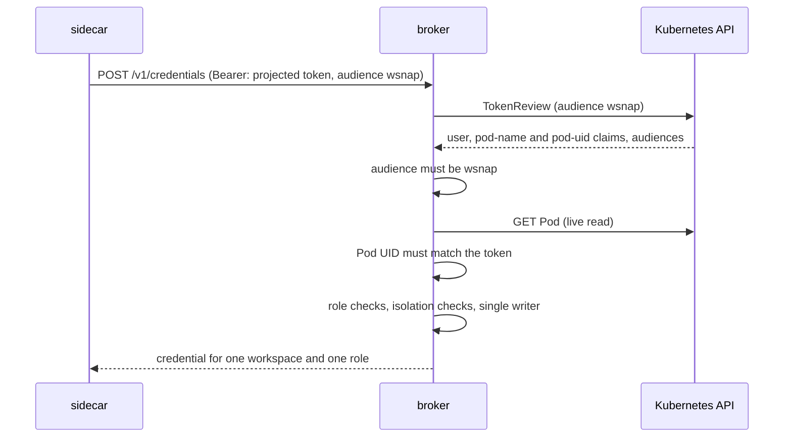

# Security

This document gives the threat model, the controls, and the known limits.

## Threat model

wsnap assumes that the code in the agent container is **not trusted**. An
agent runs code that a language model wrote, and a prompt injection can
control it. The agent container can read and write the whole workspace
volume.

wsnap protects against these attacks from the agent container:

| Attack | Control |
|---|---|
| Read another workspace's snapshots | Each credential opens one workspace repository only. |
| Delete or corrupt snapshot history | Writing roles cannot delete (except engine scratch objects). |
| Get a credential at all | The agent container has no token for the broker's audience. |
| Get Kubernetes API access to create Pods that ask for credentials | Pods that mount the default API token are refused. |
| Read the sidecar's memory or environment through `/proc` | Pods with a shared process namespace are refused. |
| Lead the sidecar out of the volume with symlinks | File operations on the volume go through `os.Root`. |
| Replace the sidecar's binaries | The sidecar's root filesystem is read-only. |
| Restore over the workspace, or roll it back | The restore role needs a control-plane request that the Pod claimed. |

wsnap trusts the namespace's users. A user who can create Pods in a
namespace can get credentials for that namespace's workspaces. **The
namespace is the trust boundary.**

## How a request is authenticated

1. Kubernetes mounts a projected service account token into the sidecar
   only. The token has the audience `wsnap` and lives 10 minutes.
2. The broker sends the token to the API server in a TokenReview. A token
   for another audience fails. The default API token fails.
3. The token carries the Pod name and UID. The broker reads the Pod and
   compares the UID. A token of an earlier Pod with the same name fails.
4. The broker refuses the Pod when any workload container (init, regular or
   ephemeral) mounts the token volume.

## Roles

| Role | Granted to | Storage permission |
|---|---|---|
| `restore` | a workspace Pod before any workload container started; after that, only for a `WorkspaceRestore` this Pod claimed | read |
| `snapshot` | the writer Pod of the workspace | read, write; delete only engine scratch objects |
| `mover` | Pods of wsnap mover and restorer Jobs (the Job must carry wsnap's labels) | as `snapshot` |
| `maintenance` | Pods of wsnap maintenance Jobs | read, write, delete |

Engine scratch objects:

| Engine | Writers may delete | Why |
|---|---|---|
| Kopia | `s*` | Kopia deletes its session marker when a write session ends. |
| restic | `locks/` | restic deletes its lock file after each command. |

These two facts were measured against MinIO with real session policies.
Without them, Kopia fails each snapshot, and restic leaves stale locks that
block later maintenance.

## Credential providers

| Provider | How it limits a credential | Unit of isolation |
|---|---|---|
| `s3-sts` | STS `AssumeRole` with an inline session policy (AWS S3, MinIO, Ceph RGW). The effective permission is the intersection of the broker user's policy and the session policy. | object prefix |
| `gcs-downscoped` | A Credential Access Boundary: `objectViewer` for reading, `objectCreator` (cannot overwrite or delete) for writing, `objectUser` only on scratch prefixes. | object prefix |
| `azure-sas` | A service SAS on a container. A service SAS cannot be limited to a prefix in a flat-namespace account. | one container per workspace |
| `static` | None: the agent gets the admin credential. Use it only where all workspaces trust each other. | none |

The listing permission is limited to `prefix/` and `prefix/*`. The bare
prefix would also match a sibling workspace, for example `ns/ws2`.

## Fail closed

| Situation | Result |
|---|---|
| Labeled Pod, webhook running | The webhook adds the sidecar, or refuses the Pod with the reason. |
| Labeled Pod, webhook not reachable | The API server refuses the Pod (`failurePolicy: Fail`). |
| Unlabeled Pod | The webhook never sees it (`objectSelector`). |
| Broker not reachable when a Pod starts | The agent container does not start. |
| Broker not reachable when a Pod stops | The final snapshot fails. The PV stays `Retain` and is rescued later. |
| Any credential request | Refused unless every check passes. |

The webhook refuses a labeled Pod that:

- has no workspace volume,
- sets `automountServiceAccountToken: true`,
- sets `shareProcessNamespace` or `hostPID`,
- lets a workload container mount the wsnap token,
- runs the wsnap container as a regular container instead of a native sidecar,
- brings its own sidecar without a startup probe.

It also refuses an ephemeral (debug) container that mounts the wsnap token
or targets the sidecar.

## The workspace volume is hostile input

The agent container can write anywhere in the volume, including `.wsnap`.
It can plant symlinks there. The sidecar runs as root to read and restore
every file. So the sidecar treats `.wsnap` as hostile:

1. Every file operation on the volume goes through Go's `os.Root`. A
   symlink that points out of the volume fails.
2. `.wsnap` must be a plain directory owned by the agent. The agent refuses
   a symlink, a file, or a directory owned by another user.
3. The injected sidecar has a read-only root filesystem. It keeps only
   `CHOWN`, `DAC_OVERRIDE`, `DAC_READ_SEARCH`, `FOWNER` and `FSETID`.

**Known limit.** Kopia and restic resolve the staging path themselves. A
workload that swaps the staging directory after the agent checked it, and
before the engine writes, could redirect the write. The read-only root
filesystem limits the target to the agent's private state directory. The
credentials there open only the attacker's own workspace.

## Transport

The broker serves plain HTTP unless you set `--tls-cert-file` and
`--tls-key-file`. Without TLS, credentials cross the Pod network
unencrypted. With TLS, give agents the CA with `--ca-file`. Give Jobs the
CA with `--agent-ca-configmap`. The broker reloads a rotated certificate
from disk.

## Gateway API

The gateway API does not add a permission model. The caller sends its own
Kubernetes token. The broker checks it with a TokenReview, and checks the
caller's RBAC with a SubjectAccessReview for the same verb on the request
resource. The created request records the caller in the
`wsnap.dev/requested-by` annotation.

## Known limits

- **S3 overwrite.** `s3:PutObject` also allows overwriting an object. Turn on
  bucket versioning or Object Lock to make history tamper-evident.
- **Azure writers can delete** inside their own container. Turn on soft
  delete or versioning.
- **The filesystem backend has no isolation** between workspaces.
- **The controller can read every Secret** (`get`). Limit it with a Role per
  tenant namespace if needed.
